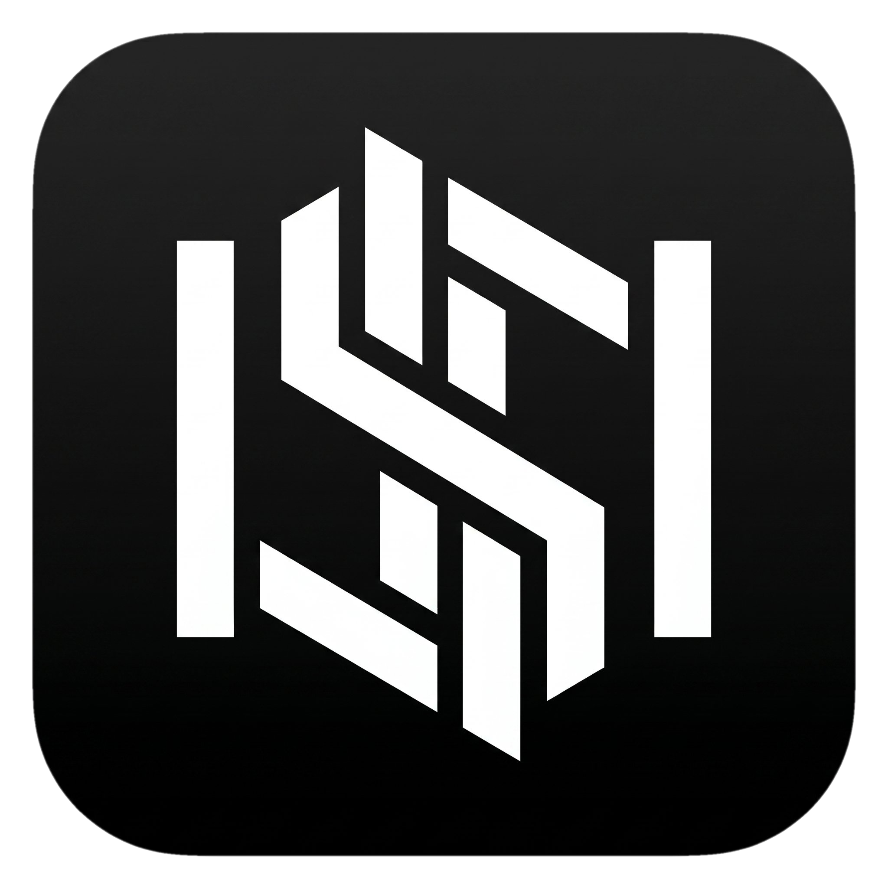
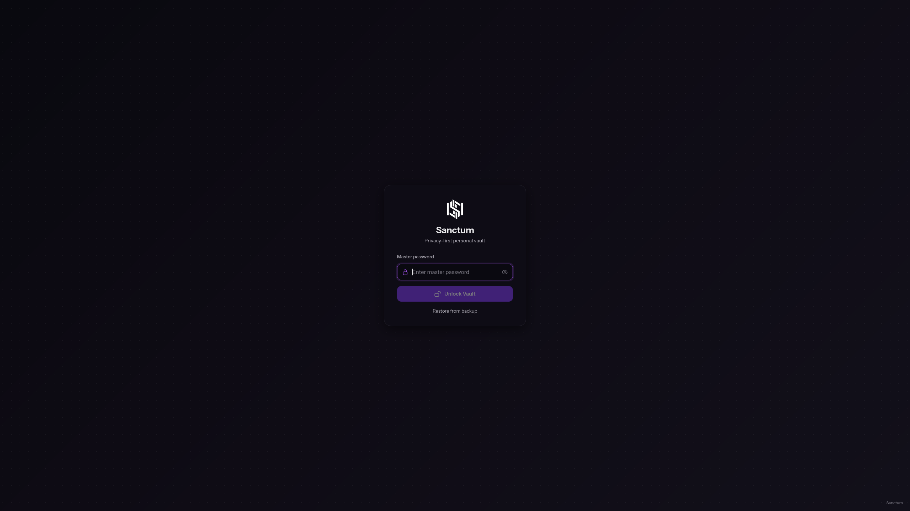

<div align="center">



<h1>Sanctum</h1>

<p><b>A private, encrypted vault for your money and your crypto.</b><br />
Local-first. No accounts, no telemetry, no cloud.</p>

[](LICENSE)


**[Español](README.md)** · **[Website](https://yfloress.github.io/Sanctum/)** · **[Install guide](docs/INSTALL.md)** · **[Crypto tax](docs/CRYPTO_TAX.md)**

<br />



</div>

> [!CAUTION]
> **Alpha software.** Sanctum is under active development and may change without
> notice. Keep your own backups.

## Why Sanctum

Your financial life says more about you than almost anything else. Sanctum keeps
it on a device you own, in a database only your password opens.

- **Yours alone.** The whole database is encrypted with a master password that
  never leaves your device. There is no account to create and no company that can
  read it, lose it or be asked for it.
- **Offline by default.** Sanctum makes no network request unless you ask it to.
  Imports, reports and taxes all run locally.
- **Finances and crypto together.** Bank accounts, cards, credits and wallets in
  one place, with one net worth.

## Features

### Finances
- Accounts in several currencies (CLP, USD, EUR and more), transfers, categories and tags.
- Monthly budgets, recurring entries, and credits with their installment schedule.
- Reconciliation against your bank's balance.
- A one-line quick entry: `5000 lunch` and Enter.

### Bank statements
Drop a statement PDF and review every row before it is imported.
- Rows already in the account are recognised and left out.
- Categories are learned from how you filed the same merchant before.
- Transfers between your own accounts are detected, so money moved is never
  counted as spending twice.
- Password-protected PDFs open with your password, which is not stored.
- The parsed rows are checked against the statement's own totals.

### Crypto
- Wallets, trades, swaps and transfers, with portfolio history.
- Imports from exchange and wallet exports (see below), a read-only Kraken
  connection, and folders that pick up new CSV exports automatically.
- An **offline tax engine** for Chile (SII), the United States (IRS) and other
  jurisdictions, with the cost-basis method each one requires (FIFO, average
  cost and more). See **[CRYPTO_TAX.md](docs/CRYPTO_TAX.md)**.

### Dashboard
Net worth and its trend across finances and crypto, spending by category, and recent activity.

## Imports

Everything is parsed **on your device**. Files are validated row by row,
duplicates are skipped, and reimporting the same history changes nothing.

**Bank statements (PDF)**

| Bank | Account statement | Credit card statement |
| :-- | :-: | :-: |
| Banco de Chile | Yes | Yes |
| Santander | Yes | Yes |
| BancoEstado | Yes | — |
| CopecPay | Yes | — |
| Mercado Pago | Yes | — |

**Exchanges and wallets**

| Source | What to export |
| :-- | :-- |
| Kraken | `Ledgers` and `Trades` CSV, or a read-only API key with only *Query ledger entries* |
| Binance | `All Statements` and `Spot Trade History` CSV |
| MEXC | Account data export (17 report types) |
| NotBank (ex-CryptoMarket) | `Transaction` and `Trade Activity` reports |
| Feather Wallet | History CSV (also from a view-only wallet) |
| Monero GUI | History CSV |
| Anything else | Any CSV, by mapping its columns |

Generic JSON and CSV files are supported too, for moving data in and out.

## Privacy and security

- **Encryption at rest.** SQLCipher (AES-256, keys derived with PBKDF2-HMAC-SHA512)
  encrypts the entire database. Backups are copies of that encrypted file.
- **No telemetry, ever.** There is nothing to opt out of.
- **Prices without revealing your portfolio.** Price sync is off by default. When
  you turn it on, Sanctum asks for the same set of the 250 largest coins as every
  other user, so the request says nothing about what you hold. A coin outside that
  set is only looked up after you agree to it.
- **Proxy and Tor.** Network requests can go through a SOCKS5 or HTTP proxy. If the
  proxy fails, the request fails too: it never falls back to a direct connection.
- **Credentials stay in the vault.** An exchange API key is stored inside the
  encrypted database and used read-only.

> [!NOTE]
> Any request to an outside service shows your IP address to that service unless it
> goes through a proxy. Sanctum keeps those requests rare, optional and uninformative.

**Moving to another computer:** install Sanctum, choose *Restore from backup* on the
first screen, pick your exported backup and unlock it with your usual password.

## Platforms and roadmap

**Today:** a native desktop app for Linux, macOS and Windows.

**Next, in order:**
1. **Android**, in progress.
2. **A self-hosted Sanctum server**, so one vault can be shared by all your devices
   over your own network or a mesh VPN such as Tailscale, never exposed to the internet.
3. **A web app** on that server, which brings iOS and any other browser along.

> [!IMPORTANT]
> There will never be a Sanctum cloud. The only server will be one **you** run, on
> hardware **you** control.

## Installation

Full instructions for Linux, macOS and Windows are in the
**[installation guide](docs/INSTALL.md)**. The quickest way is the bundled
[`install.sh`](install.sh), which builds from source:

```bash
git clone https://github.com/yfloress/Sanctum.git
cd Sanctum
./install.sh --user   # builds and installs to ~/.local, no sudo
```

### Development

The environment is a Nix flake; the frontend uses pnpm. From the repository root:

```bash
direnv allow                            # or: nix develop
cd ui-svelte && pnpm install && cd ..   # first time only
cargo tauri dev                         # run in development mode
cargo tauri build                       # build a release binary
```

Android, still in progress:

```bash
cargo tauri android dev     # run on a connected device
cargo tauri android build   # build an APK / AAB
```

## Tech stack

| Layer | Technology | Role |
| :-- | :-- | :-- |
| Core | Rust | Business logic, validation, taxes, imports |
| Shell | Tauri 2 | Native window and system integration |
| Interface | Svelte 5 + TypeScript | The user interface, built with Vite |
| Storage | SQLite + SQLCipher | Encrypted local database |
| Environment | Nix | Reproducible development setup |

One Rust core is meant to serve every target, so the logic lives in one place.

## How it is built

- **Human-led design.** Privacy and data integrity come first, and the architecture is
  decided by a person.
- **AI-assisted code.** Most of the code is written or refactored with frontier models.
  A person sets the structure and scope of every change and reviews it, and nothing is
  merged until it passes `cargo fmt`, `cargo clippy -D warnings`, the full test suite,
  `cargo machete` and `cargo deny`.
- **Open to audit.** The full source is here, so you can check for yourself that
  nothing leaves your device.

## Contributing

Bugs and ideas are welcome in the [issue tracker](https://github.com/yfloress/Sanctum/issues).

## License

Sanctum is free software under the **GNU Affero General Public License v3.0**. See
[LICENSE](LICENSE). Third-party fonts, icons and logos, with their licenses, are
listed in [NOTICE.md](NOTICE.md).
