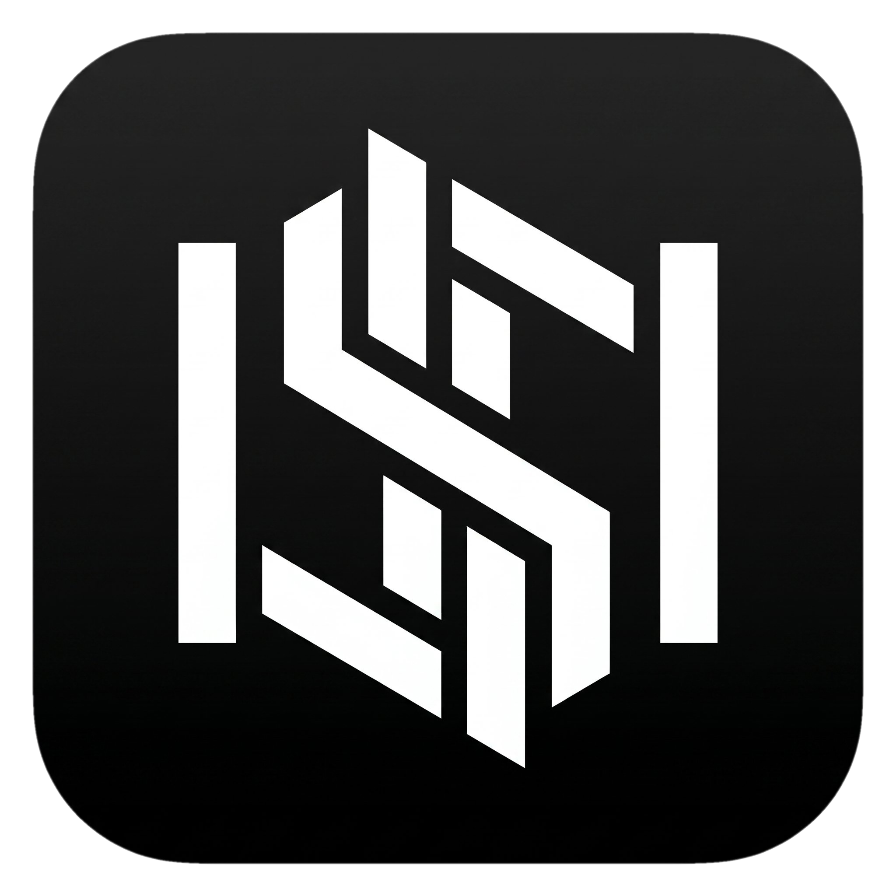
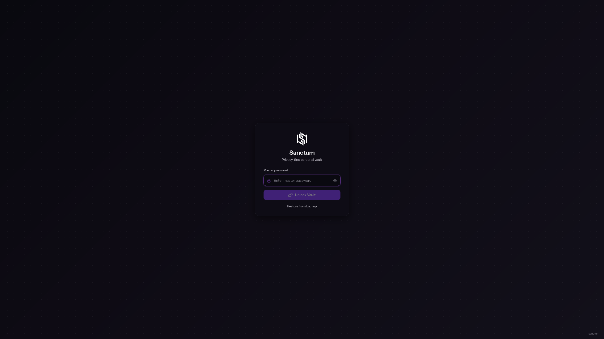

<div align="center">



<h1>Sanctum</h1>

<p><b>Una bóveda privada y cifrada para tu dinero y tus criptomonedas.</b><br />
Local primero. Sin cuentas, sin telemetría, sin nube.</p>

[](LICENSE)


**[English](README.md)** · **[Sitio web](https://yfloress.github.io/Sanctum/)** · **[Guía de instalación](docs/INSTALL_ES.md)** · **[Impuestos cripto](docs/CRYPTO_TAX.md)**

<br />



</div>

> [!CAUTION]
> **Software en fase alfa.** Sanctum está en desarrollo activo y puede cambiar sin
> aviso. Mantén tus propios respaldos.

## Por qué Sanctum

Tu vida financiera dice de ti más que casi cualquier otra cosa. Sanctum la guarda
en un dispositivo tuyo, en una base de datos que sólo abre tu contraseña.

- **Sólo tuya.** Toda la base de datos se cifra con una contraseña maestra que
  nunca sale de tu dispositivo. No hay cuenta que crear ni empresa que pueda
  leerla, perderla o entregarla.
- **Sin conexión por defecto.** Sanctum no se conecta a internet salvo que tú lo
  pidas. Las importaciones, los informes y los impuestos se calculan en tu equipo.
- **Finanzas y cripto juntas.** Cuentas, tarjetas, créditos y billeteras en un
  solo lugar, con un solo patrimonio.

## Funciones

### Finanzas
- Cuentas en varias monedas (CLP, USD, EUR y más), transferencias, categorías y etiquetas.
- Presupuestos mensuales, movimientos recurrentes y créditos con su calendario de cuotas.
- Conciliación contra el saldo de tu banco.
- Entrada rápida en una línea: `5000 almuerzo` y Enter.

### Cartolas bancarias
Arrastra la cartola en PDF y revisa cada fila antes de importarla.
- Las filas que la cuenta ya tiene se reconocen y quedan fuera.
- Las categorías se aprenden de cómo clasificaste antes ese mismo comercio.
- Detecta las transferencias entre tus propias cuentas, para que el dinero que
  mueves nunca se cuente dos veces como gasto.
- Los PDF protegidos se abren con tu contraseña, que no se guarda.
- Las filas leídas se comparan con los totales de la propia cartola.

### Cripto
- Billeteras, compras, ventas, intercambios y transferencias, con historial del portafolio.
- Importación de exportaciones de exchanges y billeteras (ver más abajo), conexión
  de sólo lectura con Kraken y carpetas que toman solas las nuevas exportaciones CSV.
- Un **motor tributario sin conexión** para Chile (SII), Estados Unidos (IRS) y
  otras jurisdicciones, con el método de costo que exige cada una (FIFO, costo
  promedio y más). Ver **[CRYPTO_TAX.md](docs/CRYPTO_TAX.md)**.

### Dashboard
Patrimonio y su evolución entre finanzas y cripto, gasto por categoría y movimientos recientes.

## Importación

Todo se procesa **en tu dispositivo**. Cada fila se valida, los duplicados se
omiten y volver a importar el mismo historial no cambia nada.

**Cartolas bancarias (PDF)**

| Banco | Cartola de cuenta | Estado de cuenta de tarjeta |
| :-- | :-: | :-: |
| Banco de Chile | Sí | Sí |
| Santander | Sí | Sí |
| BancoEstado | Sí | — |
| CopecPay | Sí | — |
| Mercado Pago | Sí | — |

**Exchanges y billeteras**

| Origen | Qué exportar |
| :-- | :-- |
| Kraken | CSV de `Ledgers` y `Trades`, o una API key de sólo lectura con únicamente *Query ledger entries* |
| Binance | CSV de `All Statements` y `Spot Trade History` |
| MEXC | Exportación de datos de la cuenta (17 tipos de informe) |
| NotBank (ex-CryptoMarket) | Informes de `Transaction` y `Trade Activity` |
| Feather Wallet | CSV del historial (también desde una billetera de sólo lectura) |
| Monero GUI | CSV del historial |
| Cualquier otro | Cualquier CSV, asignando sus columnas |

También acepta JSON y CSV genéricos, para mover datos hacia adentro y hacia afuera.

## Privacidad y seguridad

- **Cifrado en reposo.** SQLCipher (AES-256, con claves derivadas con
  PBKDF2-HMAC-SHA512) cifra toda la base de datos. Los respaldos son copias de ese
  archivo cifrado.
- **Nunca hay telemetría.** No hay nada que desactivar.
- **Precios sin revelar tu portafolio.** La sincronización de precios viene apagada.
  Si la activas, Sanctum pide el mismo conjunto de las 250 monedas más grandes que
  cualquier otro usuario, así que la consulta no dice nada de lo que tienes. Una
  moneda fuera de ese conjunto sólo se consulta después de que aceptes.
- **Proxy y Tor.** Las conexiones pueden pasar por un proxy SOCKS5 o HTTP. Si el
  proxy falla, la conexión falla también: nunca se hace directa por detrás.
- **Las credenciales quedan en la bóveda.** La API key de un exchange se guarda
  dentro de la base de datos cifrada y se usa sólo para leer.

> [!NOTE]
> Cualquier conexión a un servicio externo le muestra tu dirección IP a ese
> servicio, salvo que pase por un proxy. Sanctum hace esas conexiones pocas veces,
> sólo si las pides y sin revelar nada.

**Para cambiarte de computador:** instala Sanctum, elige *Restaurar desde respaldo*
en la primera pantalla, selecciona el respaldo que exportaste y desbloquéalo con tu
contraseña de siempre.

## Plataformas y hoja de ruta

**Hoy:** una aplicación de escritorio nativa para Linux, macOS y Windows.

**Lo que sigue, en orden:**
1. **Android**, en desarrollo.
2. **Un servidor de Sanctum autohospedado**, para compartir una bóveda entre todos
   tus dispositivos por tu propia red o una VPN como Tailscale, sin exponerla nunca
   a internet.
3. **Una aplicación web** en ese servidor, que suma iOS y cualquier otro navegador.

> [!IMPORTANT]
> Nunca habrá una nube de Sanctum. El único servidor será uno que **tú** administres,
> en equipos que **tú** controlas.

## Instalación

Las instrucciones completas para Linux, macOS y Windows están en la
**[guía de instalación](docs/INSTALL_ES.md)**. Lo más rápido es el
[`install.sh`](install.sh) incluido, que compila desde el código fuente:

```bash
git clone https://github.com/yfloress/Sanctum.git
cd Sanctum
./install.sh --user   # compila e instala en ~/.local, sin sudo
```

### Desarrollo

El entorno es un flake de Nix y el frontend usa pnpm. Desde la raíz del repositorio:

```bash
direnv allow                            # o: nix develop
cd ui-svelte && pnpm install && cd ..   # sólo la primera vez
cargo tauri dev                         # modo desarrollo
cargo tauri build                       # compila la versión final
```

Android, todavía en desarrollo:

```bash
cargo tauri android dev     # ejecuta en un dispositivo conectado
cargo tauri android build   # compila un APK / AAB
```

## Tecnologías

| Capa | Tecnología | Función |
| :-- | :-- | :-- |
| Núcleo | Rust | Lógica, validación, impuestos e importaciones |
| Contenedor | Tauri 2 | Ventana nativa e integración con el sistema |
| Interfaz | Svelte 5 + TypeScript | La interfaz, compilada con Vite |
| Almacenamiento | SQLite + SQLCipher | Base de datos local cifrada |
| Entorno | Nix | Entorno de desarrollo reproducible |

Un solo núcleo en Rust sirve a todas las plataformas, así que la lógica vive en un solo lugar.

## Cómo se construye

- **Diseño dirigido por una persona.** La privacidad y la integridad de los datos van
  primero, y la arquitectura la decide una persona.
- **Código asistido por IA.** La mayor parte del código se escribe o refactoriza con
  modelos de frontera. Una persona define la estructura y el alcance de cada cambio y
  lo revisa, y nada se integra sin pasar `cargo fmt`, `cargo clippy -D warnings`, la
  suite completa de tests, `cargo machete` y `cargo deny`.
- **Abierto a auditoría.** Todo el código está aquí, para que compruebes por tu
  cuenta que nada sale de tu dispositivo.

## Contribuir

Los errores y las ideas son bienvenidos en el [gestor de issues](https://github.com/yfloress/Sanctum/issues).

## Licencia

Sanctum es software libre bajo la **GNU Affero General Public License v3.0**. Ver
[LICENSE](LICENSE).
